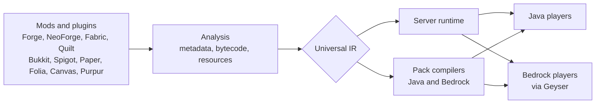

<!-- README version: 0.1.0 | last updated: 2026-10-11 | matches MASTER-SPEC-STATUS v1.0.50 | rule: update after every completed pass -->

# VESSEL

**Virtualized Ecosystem Shared Server & Engine Loader**

One server for the mods and plugins of every major Minecraft ecosystem.

> **Status: research and design.** There is no release, no installer and no runnable code yet. Everything below describes the goal and the plan, not a working product.

## What is VESSEL

VESSEL is a planned server-side loader. It reads mods and plugins written for different loaders, converts what they do into one shared intermediate representation (IR), and runs that on a single server. Players join with a vanilla Java client or a Bedrock client; the server builds the resource packs and add-ons they need.

It is **not** a translator from one loader's API to another. The aim is to separate what a mod or plugin *means* from the loader it was written for, then compile that meaning for the target.

## Goals

- **One runtime, many sources.** Forge, NeoForge, Fabric and Quilt mods, and Bukkit, Spigot, Paper, Folia, Canvas and Purpur plugins, in the same server.
- **The server is the source of truth.** Gameplay, physics and state live on the server; the client only presents.
- **No hard-coded Minecraft versions.** Support is meant to cover every version of every supported loader, driven by a version registry.
- **Data stays where it belongs.** Binaries, configuration, persistent data, caches and generated files are kept apart, and a mod that writes files by relative path keeps working.
- **Nothing fails silently.** What cannot be converted is reported with its reason, and the rest of the mod keeps running.

## How it is meant to work

The exact shape of the runtime is part of the design work still under way.

## Project status

This section is rewritten after every completed pass of work.

| Area | State |
|---|---|
| Specification | The original 625-point specification is in [`docs/original/`](docs/original/); 36 design decisions are recorded in [`MASTER-SPEC-STATUS.md`](MASTER-SPEC-STATUS.md). Two draft specifications (distribution and loader architecture, website) are in [`docs/drafts/`](docs/drafts/) and are not final. |
| Forge research | Research table complete: 37 of 37 rows done (one with a documented limit, two accepted through a scope decision). The research gate is **not signed off** yet. See [`docs/upstream/forge/research.md`](docs/upstream/forge/research.md). |
| Reference study of Sinytra Connector | In progress: 2 of 26 rows done, 8 partly done (23.1% by the project's counting rule). Connector runs Fabric mods on Forge and NeoForge; it is studied for ideas, and none of its code is used here. See [`docs/upstream/sinytra/`](docs/upstream/sinytra/). |
| Research of other loaders | Not started (Fabric, NeoForge, Quilt, the Bukkit family, Bedrock and Geyser). |
| Implementation | Not started. No adapter, runtime, installer or tests exist. |
| **Whole plan** | **About 6.3%** of the 23-phase plan below, almost all of it research and design. |

The 23-phase plan and progress per phase

| Phase | Name | Status | Estimate |
|---|---|---|---|
| 1 | Core + Version Registry | PARTIAL | 15% |
| 2 | Universal Module Metadata | PARTIAL | 5% |
| 3 | Virtual Filesystem | PARTIAL | 10% |
| 4 | Paper/Bukkit Plugin Adapter | NOT STARTED | 0% |
| 5 | Plugin Data/Config Compatibility | NOT STARTED | 0% |
| 6 | Fabric Adapter | PARTIAL | 5% |
| 7 | Forge Adapter | DONE (research part) | 100% |
| 8 | NeoForge Adapter | NOT STARTED | 2% |
| 9 | Quilt Adapter | NOT STARTED | 0% |
| 10 | Folia Scheduler/Threading | NOT STARTED | 0% |
| 11 | Canvas/Purpur | NOT STARTED | 0% |
| 12 | UIR Core | NOT STARTED | 0% |
| 13 | Block/Item/Entity abstraction | NOT STARTED | 0% |
| 14 | Resource Pack Compiler | PARTIAL | 3% |
| 15 | Datapack Compiler | NOT STARTED | 0% |
| 16 | Display/Model/Animation backend | NOT STARTED | 0% |
| 17 | Physics | NOT STARTED | 0% |
| 18 | Dynamic Scene/Contraptions | NOT STARTED | 0% |
| 19 | Bytecode conversion | NOT STARTED | 0% |
| 20 | Mixin/Transformer semantic conversion | PARTIAL | 5% |
| 21 | Geyser/Bedrock | NOT STARTED | 0% |
| 22 | Advanced migration | NOT STARTED | 0% |
| 23 | Full compatibility test matrix | NOT STARTED | 0% |

The estimates cover research and design only. A phase marked "DONE (research part)" means its research is finished; nothing for that phase has been implemented.

## Planned support

| Kind | Planned |
|---|---|
| Sources | Forge, NeoForge, Fabric, Quilt mods; Bukkit, Spigot, Paper, Folia, Canvas, Purpur plugins; Java resource and data packs; Bedrock resource packs, behavior packs and add-ons |
| Server targets | Paper, Folia, Canvas, Purpur, Spigot, Bukkit (from the original specification; subject to the design work) |
| Players | Java (vanilla client, with generated packs) and Bedrock through Geyser |

All of this is a plan. Nothing in the table is implemented.

## Documentation

- [`MASTER-SPEC-STATUS.md`](MASTER-SPEC-STATUS.md): current state, every recorded decision, the progress tables.
- [`LOG.md`](LOG.md): a dated log of every change to the documentation.
- [`docs/architecture/`](docs/architecture/): module identity and collision rules, the startup build stage.
- [`docs/upstream/`](docs/upstream/): research on the loaders and on Sinytra Connector.

## Contributing

Code contributions are not accepted yet, because there is no code. Issues with questions or corrections to the documentation are welcome once the repository is public.

## Credits and prior art

VESSEL builds on the public work of MinecraftForge, NeoForged, FabricMC, QuiltMC, PaperMC, GeyserMC and the Sinytra projects, whose documentation and source were read as research. Those projects own their code and names.

## License

Not chosen yet. It will be decided before the first release. Until a license file is added, no permission to reuse the text or code of this repository is granted.

## Disclaimer

VESSEL is not affiliated with or endorsed by Mojang Studios, Microsoft or any project named above. Minecraft is a trademark of Mojang Studios.
