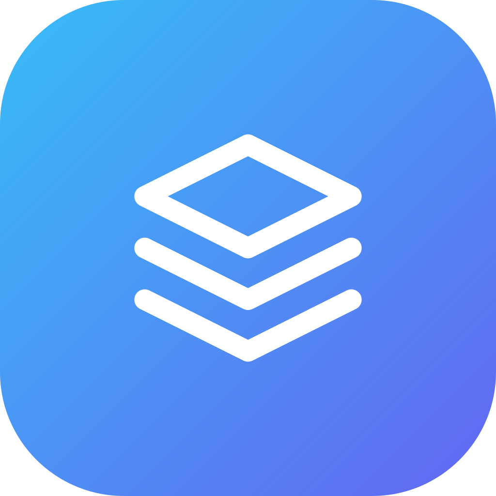
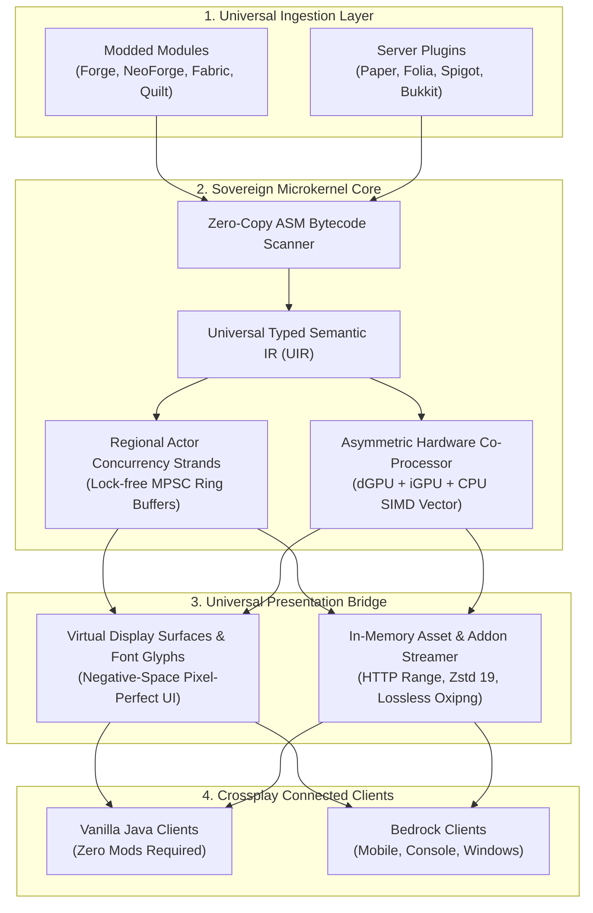

<div align="center">



# VESSEL
### Sovereign Universal Standalone Microkernel Server Engine

**One Server. Every Mod. Every Plugin. Zero Client Modifications.**

*A high-throughput, sovereign server runtime unifying modded and plugin ecosystems into a single living world — powered by Single-Pass Bytecode Weaving, Asymmetric Heterogeneous Computing (dGPU + iGPU + CPU), Regional Actor Concurrency, and Native 60 FPS Client Presentation.*

---

[](https://openjdk.org/projects/jdk/21/)
[](https://www.minecraft.net/)
[](LICENSE)
[](#)
[](https://central.sonatype.com/artifact/io.github.vesselloader/vessel-api)
[](#)
[](#)

</div>

---

## What is VESSEL?

For over a decade, Minecraft server administration has been trapped in walled gardens. Mod ecosystems and server plugin platforms were built on completely incompatible foundations. Previous attempts to bridge them relied on "parasitic wrappers"—running multiple heavy runtime engines on top of each other—inevitably resulting in severe memory leaks, classloader deadlocks, and devastating performance degradation.

**VESSEL takes a fundamentally different path.**

VESSEL is not a mod, not a plugin, and not a wrapper. It is an **independent, sovereign server microkernel** engineered from the ground up. Instead of emulating alien runtime environments, VESSEL ingests mods and plugins from any ecosystem (Fabric, Quilt, Forge, NeoForge, Bukkit, Spigot, Paper, Folia), breaks them down into a unified **Universal Typed Semantic Intermediate Representation (UIR)**, and weaves them directly into a high-performance multithreaded game engine.

The result? **A server that runs your favorite mods and plugins simultaneously with unmatched performance, while allowing players on standard, unmodded Vanilla Java and Bedrock clients to join without installing a single mod.**

---

## 🌟 The Game-Changing Advantages of VESSEL

### 1. True Ecosystem Unity without Parasitic Wrappers
* **Traditional Platforms:** Force server owners to pick a side. Hybrid server attempts bolt two full modding engines together inside one JVM, causing constant Mixin conflicts, Metaspace memory leaks, and unpredictable crashes.
* **The VESSEL Advantage:** Features a **Single-Pass Bytecode Pipeline**. Mods and plugins are analyzed and normalized at class-load time into a unified semantic contract. There are no competing loader runtimes, no duplicate classloaders, and zero runtime overhead.

### 2. Complete Client Freedom — Join with 100% Vanilla Clients
* **Traditional Platforms:** Running a modded server requires every single player to download a custom launcher, configure Java versions, and install a heavy modpack just to connect.
* **The VESSEL Advantage:** **The server is the sovereign source of truth.** Custom blocks, complex industrial machinery, animated bosses, and magic spells execute their logic purely server-side. Players on **Vanilla Java Clients** and **Bedrock Clients (Mobile, Console, PC)** can jump in immediately without installing client-side mods.

### 3. The Death of "Virtual Chests" — Pixel-Perfect Custom GUIs
* **Traditional Platforms:** To display custom interfaces to vanilla players, servers have historically relied on "virtual chest" menus—awkwardly hijacking container inventories, which feels clunky and breaks immersion.
* **The VESSEL Advantage:** Introduces the **Negative-Space Font Glyph UI Engine** and **Virtual Display Surfaces**. Custom machine interfaces, mana bars, cast progress indicators, and spell selection wheels render smoothly at 60 FPS directly on the player's screen with pixel-perfect fidelity, eliminating chest menus forever.

### 4. Asymmetric Tri-Tier Hardware Acceleration (dGPU + iGPU + CPU)
* **Traditional Platforms:** Completely ignore modern server hardware. Even if your server host has an integrated GPU or dedicated graphics card, traditional engines leave it 100% idle while the CPU struggles under heavy load.
* **The VESSEL Advantage:** VESSEL is the first server engine to introduce **Heterogeneous Tri-Processing**:
  * **Dedicated GPU (dGPU):** Takes over massive parallel batch workloads—baking multi-resolution texture atlases, compressing textures on hardware (BC7 for PC, ASTC for mobile), and running heavy particle physics simulations (> 100,000 particles).
  * **Integrated GPU (iGPU):** Leverages Unified Memory Architecture (UMA) to share host RAM with the CPU with **zero PCIe copy latency**. It calculates per-tick entity bone animations, line-of-sight raytracing, and dynamic lighting directly in system memory.
  * **CPU & SIMD Fallback:** Orchestrates the core game loop and actor threads. If no GPU is present (e.g. budget VPS), VESSEL automatically falls back to **Java 21 SIMD Vector Intrinsics (AVX-512, AVX2, ARM Neon)**, acting like a "mini-GPU" inside the CPU.

### 5. Regional Multithreading with Lock-Free Concurrency
* **Traditional Platforms:** Bound to a single main thread for world ticking. When an explosion occurs or a large factory runs, the entire server grinds to a halt.
* **The VESSEL Advantage:** Divides world simulation into thread-safe **Regional Strands** (16x16 chunk regions). Energy, fluid, and mechanical contraptions transfer across region borders through lock-free MPSC Ring Buffers, achieving true multi-core scaling without deadlocks or race conditions.

### 6. Zero-Allocation Hot-Paths & Rock-Solid 20.0 TPS
* **Traditional Platforms:** Allocate millions of short-lived Java objects every second during packet handling, pathfinding, and physics calculations, triggering frequent Garbage Collector (GC) lag spikes.
* **The VESSEL Advantage:** Hot execution paths operate on **flat primitive arrays, bitmasks, and off-heap native memory buffers**. Allocations on critical tick loops are reduced to exactly **0 bytes**, ensuring stable 20.0 TPS and sub-1.5ms GC pause times even under peak player concurrency.

### 7. Instant Single-Pass First Boot & Zero-Downtime Updates
* **Traditional Platforms:** Require administrators to boot the server, wait for files to generate, edit configs, accept EULAs, and manually restart multiple times.
* **The VESSEL Advantage:** Boots and launches in **1 single pass** on a brand-new directory. Furthermore, the built-in background update daemon downloads and stages updates seamlessly without lagging the active tick thread.

### 8. Fortress-Grade Security & Zero-Trust Bytecode Sandbox
* **Traditional Platforms:** Any downloaded mod runs with unrestricted permissions, capable of executing arbitrary native code, accessing host files, or exploiting known deserialization vulnerabilities.
* **The VESSEL Advantage:** Armed with a **Zero-Trust Bytecode Capability Sandbox**, memory leak sanitizers, and Linux `seccomp-BPF` system call filtering. Malicious or poorly written mods are quarantined in RAM, preventing unauthorized system calls, thread deadlocks, and container desync exploits.

---

## 🏗️ Architectural Overview



---

## 🚀 Quick Start Guide

Launching VESSEL is as straightforward as running a standard server jar.

### 1. Requirements
* **Operating System:** Linux (Ubuntu/Debian, RHEL/Rocky), Windows Server, or macOS.
* **Runtime:** **Java 21 LTS** or newer (Eclipse Temurin 21+ recommended).
* **Target Minecraft Releases:** Fully compatible with **Minecraft 26.3+** and all legacy versions (1.12.2 to 1.21.4).

### 2. Directory Layout

Place your server executable in an empty directory. VESSEL auto-generates the required folders on first boot:

```text
server-root/
├── server.jar              # VESSEL Sovereign Microkernel
├── eula.txt                # eula=true
├── mods/                   # Fabric, Quilt, Forge, NeoForge mods (.jar)
└── plugins/                # Bukkit, Spigot, Paper, Folia plugins (.jar)
```

### 3. Launching the Server

```bash
# Standard Launch:
# Automatically resolves server assets, sets up networking, and starts in 1 single pass
java -jar server.jar --nogui

# Maximum Performance Mode:
# Enables SIMD vectorization, zero-copy networking, aggressive LOD, and hardware compute
java -jar server.jar --vessel-ultra-optimize --nogui

# Pin Specific Minecraft Release:
# Runs a specific vanilla game version (e.g., 26.3 or 1.21.4)
java -jar server.jar --vessel-version=26.3 --nogui

# Diagnostic Tracing Mode:
# Prints detailed bytecode weaving and classloader dispatch telemetry
java -jar server.jar --vessel-deep-debug --nogui
```

---

## ⚙️ Key CLI Flags & Tooling

### Server Runtime Flags (`VesselServerLauncher`)

| CLI Flag | Default | Description |
| :--- | :---: | :--- |
| `--vessel-ultra-optimize` | `false` | Enables the full hardware optimization suite (SIMD Vector Physics, Zero-Copy Netty, Lockless Strands, Lazy DFU, and GPU offloading). |
| `--vessel-single-pass-boot` | `true` | Completes folder scaffolding, EULA agreement, and ecosystem initialization in a single boot cycle with no restart required. |
| `--vessel-deep-debug` | `false` | Activates granular diagnostic tracing for bytecode transformations, classloading, and actor thread dispatches. |
| `--vessel-version=<ver>` | `latest.release` | Pins a specific game release version (e.g., `--vessel-version=26.3` or `--vessel-version=1.21.4`). |
| `--vessel-universal-compat` | `true` | Automatically upgrades legacy bytecode signatures in RAM for older mod and plugin compatibility. |
| `--vessel-enforce-client-mods` | `false` | Bypasses server-side virtual rendering and enforces that connecting clients have matching mods installed via native handshake audit. |
| `--nogui` | `false` | Runs the server in headless terminal mode without opening the Swing GUI window. |

### VSTM CLI Standalone Tool (`vstm-cli`)

VESSEL provides a dedicated command-line tool for developers and administrators to compile, verify, and inspect binary transmutation packages (`.vstmb`):

```bash
# Compile a mod or plugin JAR into a VSTM binary matrix:
java -jar vstm-cli.jar compile my-mod.jar -o my-mod.vstmb

# Verify cryptographic signatures and structural integrity:
java -jar vstm-cli.jar verify my-mod.vstmb

# Inspect bytecode opcode mappings and metadata:
java -jar vstm-cli.jar inspect my-mod.vstmb
```

---

## 💻 Developer API: VESSEL Universal Super-API (VUSA)

For mod and plugin creators building cross-ecosystem addons, the official public API is distributed via **Maven Central**:

### Gradle (Kotlin DSL)

```kotlin
repositories {
    mavenCentral()
}

dependencies {
    compileOnly("io.github.vesselloader:vessel-api:1.0.0")
}
```

### Gradle (Groovy DSL)

```groovy
repositories {
    mavenCentral()
}

dependencies {
    compileOnly 'io.github.vesselloader:vessel-api:1.0.0'
}
```

### Maven

```xml
<dependency>
    <groupId>io.github.vesselloader</groupId>
    <artifactId>vessel-api</artifactId>
    <version>1.0.0</version>
    <scope>provided</scope>
</dependency>
```

---

## 🤝 Ecosystem Credits & Acknowledgments

VESSEL stands on the shoulders of giants. We honor and credit the breakthroughs of the open-source Minecraft server, modding, and performance communities:

- **Bedrock Crossplay:** [GeyserMC](https://geysermc.org) & [Floodgate](https://github.com/GeyserMC/Floodgate) (MIT License).
- **Diagnostics & Profiling:** [spark](https://spark.lucko.me) by Lucko (GPL-3.0 License).
- **Performance & Memory Leak Research:** Clean-room algorithmic adaptations credited to [Sodium/Embeddium](https://github.com/CaffeineMC/sodium-fabric), [Lithium/Radium](https://github.com/CaffeineMC/lithium-fabric), [FerriteCore](https://github.com/malte0811/FerriteCore), [MemoryLeakFix](https://github.com/fxmorin/MemoryLeakFix), [ModernFix](https://github.com/embeddedt/ModernFix), [Starlight/Moonrise](https://github.com/PaperMC/Starlight), [C2ME](https://github.com/RelativityMC/C2ME-fabric), [Krypton](https://github.com/astei/krypton), [Alternate Current](https://github.com/SpaceWalkerRS/alternate-current), [Clumps/ServerCore](https://github.com/jaredlll08/Clumps), [LazyDFU](https://github.com/astei/lazydfu), [FastSuite](https://github.com/Shadows-of-Fire/FastSuite), and [Ksyxis](https://github.com/VidTu/Ksyxis).
- **Server Architectures & APIs:** [PaperMC, Folia & Purpur](https://github.com/PaperMC/Paper), [Fabric Loader & Fabric API](https://github.com/FabricMC/fabric), [Quilt Loader & QSL](https://github.com/QuiltMC/quilt-loader), [MinecraftForge](https://github.com/MinecraftForge/MinecraftForge), [NeoForge](https://github.com/neoforged/NeoForge), and [SpongePowered Mixin / MixinExtras](https://github.com/SpongePowered/Mixin).
- **Runtime Foundations:** [OW2 ASM 9.7](https://asm.ow2.io) (BSD-3-Clause) and [Kyori Adventure](https://github.com/KyoriPowered/adventure) (MIT License).

*For detailed license notices, copyright holders, and clean-room implementation disclosures across all 28 upstream projects, see [CREDITS.md](CREDITS.md) and [NOTICE](NOTICE).*

---

## 📄 License & Commercial Exemption

VESSEL is licensed under the **[VESSEL Sovereign Kernel License & Ecosystem Agreement (VSK-EA v1.0)](LICENSE)**.

- **Personal & Educational Use:** Free to inspect, compile, run, and host for personal enjoyment, private non-commercial communities, and academic research.
- **Commercial Revenue Exemption:** Any server or operator generating **less than $1,000 USD/month** (or less than $12,000 USD/year) in gross revenue is automatically permitted to use VESSEL royalty-free without prior written authorization, provided original brand credits remain intact.
- **Mod & Plugin Independence:** Mods, plugins, and addons created for VESSEL are legally deemed "Independent Works." Creators retain 100% intellectual property rights over their plugins and are free to license them under any open-source or commercial terms.
- **Reciprocal Disclosure (Strong Copyleft on Forks):** Any public modifications or forks of the core engine deployed on public networks must publish their full source code under the identical VSK-EA v1.0 terms.

Copyright &copy; 2026 VesselLoader Team. All rights reserved.
